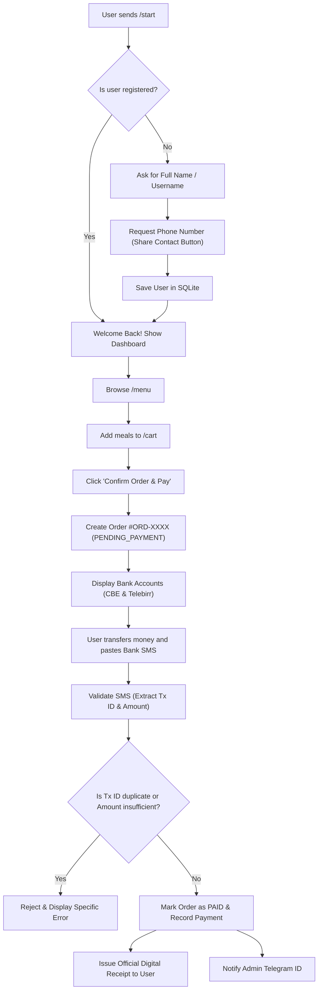

# 🍽️ Meal Bot — Telegram Food Ordering with Bank SMS Payment Authentication

A full-featured Telegram bot built with **TypeScript**, **grammY**, **Express**, and **SQLite**.

## 🌟 Key Features

1. 👤 **User Registration**: Prompts for Full Name and Phone Number (with native Telegram "Share Contact" button or text fallback).
2. 🍱 **Interactive Menu & Cart**: Browse categories, adjust quantities with inline `➕` / `➖` buttons, and checkout.
3. 💳 **Bank SMS Payment Authentication**: Generates an order, provides Bank details (CBE, Telebirr, etc.), and authenticates payment by parsing and verifying the user's forwarded or pasted **Bank confirmation SMS**.
4. 📸 **Dual-Layer Payment Verification**:
   - **Instant Automated SMS Parsing**: Instant verification of transaction code, amount, and duplicate check.
   - **Screenshot / Photo Receipt Fallback**: Customers can upload receipt screenshots; the bot forwards them to the admin with 1-click `[✅ Approve]` and `[❌ Reject]` buttons!
5. 👨‍🍳 **Real-Time Kitchen Notifications**: When the kitchen or admin changes the status to `PREPARING`, `OUT_FOR_DELIVERY`, or `COMPLETED`, the customer receives an instant push message in Telegram!
6. 🖥️ **Live Web Dashboard**: A visual kitchen and order pipeline dashboard at `http://localhost:3000` with live metrics and an interactive Bank SMS simulator.
7. 🛡️ **Anti-Fraud Security**: Prevents replay attacks (duplicate transaction IDs cannot be reused) and verifies that the transferred amount matches or exceeds the order total.

---

## 🚀 Quick Start Guide

### 1. Configure Telegram Bot Token
1. Open Telegram and search for [@BotFather](https://t.me/botfather).
2. Send `/newbot`, choose a name and username (e.g. `my_meal_ordering_bot`).
3. Copy the HTTP API token provided by BotFather.
4. Open [client/.env](file:///c:/Users/danme/Desktop/meal/client/.env) and paste your token:
   ```env
   BOT_TOKEN=123456789:ABCdefGHIjklmnoPQRstuvWXYZ
   ```

### 2. Configure Bank Transfer Accounts
In [client/.env](file:///c:/Users/danme/Desktop/meal/client/.env), configure your recipient accounts:
```env
ACCOUNT_NAME=Meal Bot / Leul Mesfin
CBE_ACCOUNT=1000123456789
TELEBIRR_ACCOUNT=0911223344
ADMIN_TELEGRAM_ID=  # Optional: your numeric Telegram ID for instant paid order alerts
```

### 3. Start the Bot
```bash
cd client
npm run dev
```

---

## 📱 Bot Workflow



---

## 🧪 Testing Bank SMS Authentication

You can test payment verification right in Telegram by placing an order and pasting sample bank SMS messages:

### Sample CBE SMS:
```text
Dear John Doe, your account 100012345678 has been debited with ETB 380.00 on 30-10-2026. Reason: Transfer to LEUL MESFIN. Transaction ID: FT241030ABCD987.
```

### Sample Telebirr SMS:
```text
Dear customer, you have transferred 380.00 Birr to Meal Bot (0911223344) on 30/10/2026 18:30:15. Transaction number is CI241030.1830.B12345.
```

The bot will automatically:
- Recognize the bank (CBE / Telebirr / BOA / Awash / etc.)
- Extract the unique transaction code (`FT241030ABCD987` or `CI241030.1830.B12345`)
- Check that this code hasn't been used before
- Check that the amount is `>=` order total
- Mark the order as **PAID** and send the confirmation receipt.

---

## 🛠️ Project Structure

- [client/src/server.ts](file:///c:/Users/danme/Desktop/meal/client/src/server.ts): Application entry point, Express server & Bot launcher.
- [client/src/bot.ts](file:///c:/Users/danme/Desktop/meal/client/src/bot.ts): Main grammY bot setup, commands (`/start`, `/menu`, `/cart`, `/orders`, `/profile`, `/help`), and inline callback query router.
- [client/src/conversations/register.ts](file:///c:/Users/danme/Desktop/meal/client/src/conversations/register.ts): 2-step user onboarding flow.
- [client/src/conversations/payment.ts](file:///c:/Users/danme/Desktop/meal/client/src/conversations/payment.ts): Bank SMS ingestion and instant verification flow.
- [client/src/keyboards.ts](file:///c:/Users/danme/Desktop/meal/client/src/keyboards.ts): Inline keyboards and custom reply keyboards.
- [client/utilis/smsParser.ts](file:///c:/Users/danme/Desktop/meal/client/utilis/smsParser.ts): Robust Bank SMS regex parser & fraud detection engine.
- [client/db/index.ts](file:///c:/Users/danme/Desktop/meal/client/db/index.ts): Synchronous SQLite database models (`users`, `menu_items`, `orders`, `payments`).
